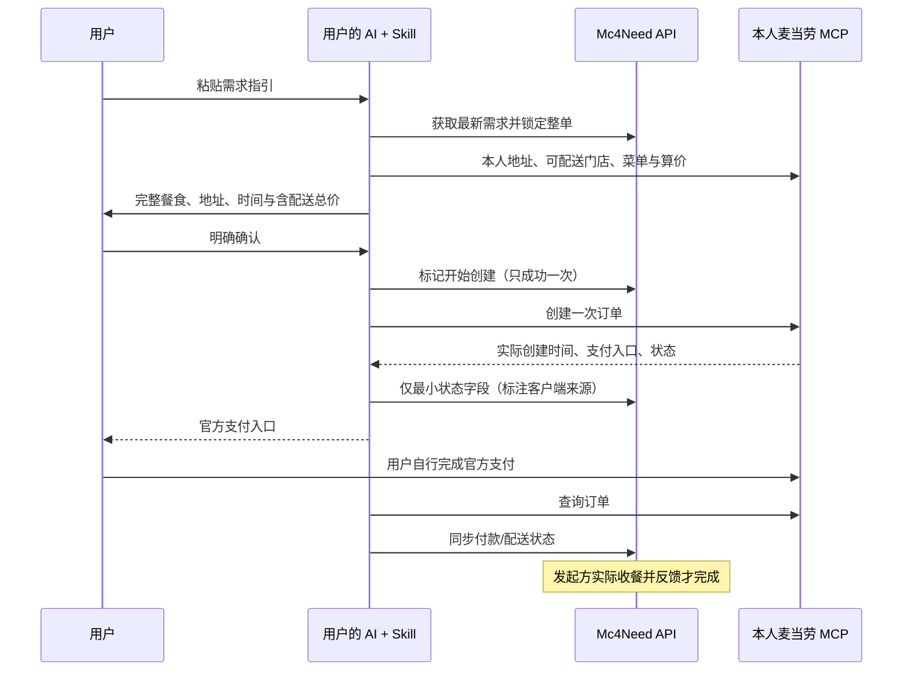

# Mc4Need × 麦当劳 MCP

## 实际调用方式

Mc4Need 服务端不连接麦当劳 MCP，不收取 Token。用户自己的 AI 客户端加载 [Skill](skill/SKILL.md)，通过其已经配置的麦当劳 MCP 调用工具。平台 CLI 负责需求、锁定、最小状态同步与双方协作。

## 工具映射

| 用途 | 官方工具 | 约束 |
|---|---|---|
| 地址 | delivery-query-addresses / delivery-create-address | 账号各自的 addressId，创建前确认真实接收信息 |
| 配送 | delivery-query-stores | 外送 orderType=2，核实 beType 和可预约时段 |
| 指定菜单 | query-meals / query-meal-detail | 规格、roundList、数量完整匹配，不擅自替换 |
| 团餐辅助 | query-meal-assistance | beType=6 时依当前 schema 获取所需服务参数 |
| 价格 | calculate-price | 赞助人本人重新算价，包含配送等费用 |
| 创建 | create-order | 具体确认后调用一次；先持久化 creating 阶段 |
| 查询/对账 | query-order / order-list | 创建结果不明时查询，不能盲目重试创建 |
| 取消 | cancel-order | 赞助人操作本人账号；取消与退款分开 |
| 可选餐品信息 | list-nutrition-foods | 只读参考，不证明门店供应，也不构成营养建议 |

使用实际客户端暴露的最新 schema，不在源码固定账号、门店或商品 ID。`party-order-create` 是主题派对，不用作本项目整单配送；`query-my-account` 不是平台身份认证。

## 已有证据与边界

2026-10-16 22:30（北京时间），在开发者实际 Codex 客户端已连接的 `mcp__mcd_mcp__list_nutrition_foods` 执行 `{}`，返回 success=true、code=200，包含 160 条餐品营养记录。本次未使用 Token 读取工具、未上传凭证、未创建订单。脱敏调用摘要见 [reports/mcp-probe.json](reports/mcp-probe.json)。

这证明当前开发客户端有一个可用的真实麦当劳 MCP 只读连接。**不能证明需求发起方与赞助人双账号配送复现、真实菜单算价、创建/支付/取消/退款、用户收餐或陌生客户端自动安装成功。** 这些需真实双方、地点、餐食、时段与金额授权后进一步验收。

平台状态机、锁、权限、幂等、消息、反馈测试使用合成数据，证据与真实 MCP 调用分开记录。初始案例明确为虚构演示，绝不以模拟完成冒充真实履约。

## 配置

参考 [mcp-config.example.json](mcp-config.example.json)，请在用户自己的客户端按官方指南配置。占位符的环境变量替换是否支持取决于客户端。不要把实际 Token 上传仓库、发到 AI 对话或交给平台；平台 `.dev.vars` 仅需要本项目加密密钥，不需要 MCD_MCP_TOKEN。

## 仍需验证

- 双账号同地点、同餐单、同时间可配送及完整算价。
- 官方实际创建时间、支付截止、未知结果、查询与取消返回。
- 真实付款后收餐反馈闭环，实际客户端 Skill 发现与跨系统端到端体验。
- 服务规则关于用途与自动化的适用边界；Skill 编排和连接成功不等于特殊授权。
- WorkBuddy 专项未完成，不提供虚构的 workbuddy.md 证据。

[官方 MCP 文档](https://github.com/M-China/mcd-mcp-server) · [服务规则](https://cdn.mcd.cn/cms/pages/MCPServerRules.html)
