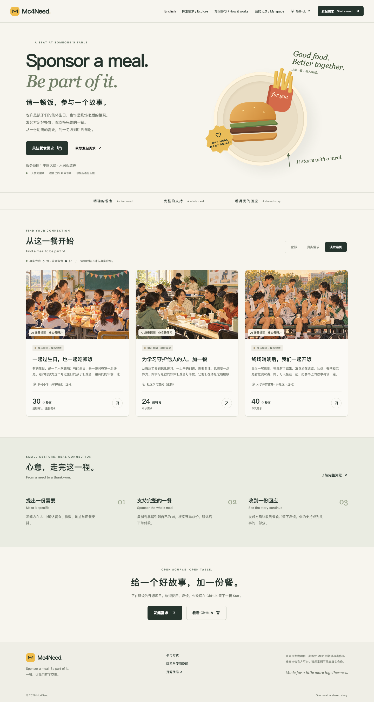

# Mc4Need

**Sponsor a meal. Be part of it.**  
请一顿饭，参与一个故事。

[English website](https://mc4need.david-widgets.com/?lang=en) · [English installation guide](public/install-guide.en.md)

[打开网站](https://mc4need.david-widgets.com) · [安装 CLI + Skill](https://mc4need.david-widgets.com/install-guide.md) · [实际验证与限制](docs/verification.md)

Mc4Need connects a specific meal need with one sponsor who covers the whole order through their own AI client and McDonald's MCP. The requester confirms receipt and shares feedback. The platform never receives the user's McDonald's Token.

发起方定好餐食、总份数、地点和用餐安排；一位赞助人承担整单，在自己的 AI 中核实金额并确认下单，通过官方入口付款。网页承载发现、地图、订单留言、收餐反馈和致谢。

> **当前为首个可用版本，真实点餐链路仍待双方授权验证。** 三个初始案例均明确标记为“演示案例 · 模拟完成”，不代表真实交易、机构合作或已完成的公益成果。接口测试使用合成订单，不调用实际支付。邮件尚未启用；站内通知可用。参赛报名和获奖均未确认。



[观看无声网页演示](docs/media/web-tour.webm)（展示公开页面、复制指引与模拟反馈，无真实付款）

## 本次更新 · v0.2.0

- 发起方可在“我的记录”上传配图；无上传时使用中国大陆场景的预置 AI 插画。
- 首页支持者入口一键复制定时关注提示词；持久化定时与通知由用户的 AI 客户端提供，复制本身不创建任务。
- 完整中英文界面、示例故事和 AI 指引；服务范围仍是中国大陆，价格为人民币，时间标注 UTC+8。

[Covers, following and localization details](docs/update-2026-10-18.md)

## 体验

1. 浏览生日、急救培训、校园篮球三类演示，理解一餐如何连接两端。
2. 点击“发起需求”，把专属 Prompt 复制到能执行命令、加载 Skill 且连接麦当劳 MCP 的 AI 客户端。
3. 发起方确认餐食和配送，生成公开需求页。首次无需邮箱或邀请。
4. 赞助人在真实需求页复制指引，重新核实本人账号下的完整订单与总价，确认后下单。
5. 双方从 AI 获取一次性网页登录链接，查看记录、留言、申请取消及确认收餐。实际收到且返回反馈后才完成。

重复需求每期重新确认，只自动准备草稿，不自动发布、点餐或扣款。姓名/昵称/匿名与统一致谢保留，不提供自定义广告权益或商业化功能。

## 安装

macOS / Linux（Codex）：

```sh
curl -fsSL https://mc4need.david-widgets.com/install.sh -o /tmp/mc4need-install.sh
sh /tmp/mc4need-install.sh codex
~/.local/bin/mc4need doctor
```

Claude Code 使用 `claude` 参数。Windows 脚本及依赖安装、校验、升级、备份和卸载说明见 [安装指南](public/install-guide.md)。实际验证范围见 [验证记录](docs/verification.md)，不把脚本存在等同 Windows、Claude Code 或 WorkBuddy 已完成实机验证。

```sh
mc4need auth guest
mc4need needs list
mc4need auth browser
```

Mc4Need CLI 仅处理平台 API；Skill 调用客户端已有麦当劳 MCP。缺少连接时请按 [官方说明](https://github.com/M-China/mcd-mcp-server) 在客户端设置，勿在聊天正文粘贴 Token。普通无终端、Skill、MCP 的网页聊天无法执行整套流程。

## 本地运行

需要 Node.js 22+。

```sh
npm ci
cp .dev.vars.example .dev.vars
# 将 APP_SECRET 替换为随机 32 字节以上密钥，只保存在本地。
npm run build
npm run db:local
npm run preview
# http://127.0.0.1:8787
```

前端热更新：另开终端 `npm run dev`，Vite 将 `/api` 代理至 8787。Worker、数据库与 UI 都可在本地运行；无需麦当劳 Token 即可查看演示与测试平台协作。

```sh
npm run typecheck
npm test
npm run test:api       # 需要本地 Worker；仅合成数据，禁止针对生产运行
npm run test:edges
npm run test:identity
npm run test:workflows
npm run test:covers
npx playwright install chromium
npm run test:ui        # 先运行上述 API/流程测试创建本地凭证夹具
```

## 实现

- React + TypeScript + Vite，可切换中英文的响应式页面、预置 AI 场景插画与发起方上传配图。
- Cloudflare Worker + Hono + D1，持久化需求、独占赞助尝试、留言与反馈。
- SHA-256 凭证哈希；AES-GCM 加密私密配送字段；HttpOnly 网页会话与一次性登录交换。
- 数据库唯一索引保证同一期仅一个有效赞助；创建后不因本地超时释放。
- 客户端同步记录带来源、时间与幂等键，不冒充官方独立验真。
- 举报、内容隐藏、异常队列、操作记录与管理员权限。
- 版本化无依赖 Node CLI、Skill、SHA-256 发布包和安装脚本。

详细说明：[架构与状态约束](docs/architecture.md) · [CLI 与 MCP 编排](skill/references/workflows.md) · [部署交接](docs/operations.md) · [产品规格](docs/product-v0.2.md)

## 麦当劳 MCP 与参赛

集成方式、实际调用证据、未验证边界见 [MCP_INTEGRATION.md](MCP_INTEGRATION.md)。配置仅包含占位符：[mcp-config.example.json](mcp-config.example.json)。[参赛声明](CONTEST_DECLARATION.md) 保留官方原文；软件许可证不替代第三方服务条款。

麦当劳点餐、支付与配送仍适用官方规则。平台不保管麦当劳 Token，不替用户操作其他人的账号，不因客户端连接成功声称获得特殊使用授权。

[官方挑战赛](https://github.com/M-China/mcd-developer-innovation-challenge)。欢迎使用、提出 Issue 或自然 Star；赞助与致谢不以 Star 为前提。尚未代用户对外发帖或提交官方报名。

## 目录

`web/` 网页 · `server/` API · `migrations/` 数据库及明确虚构的种子案例 · `cli/` 平台客户端 · `skill/` AI 操作规范 · `public/` 安装入口与发布包 · `tests/` 平台与 UI 测试 · `docs/` 产品/运营/验证 · `scripts/` 分发及维护。

本地原始附件、历史评估、密钥、身份、数据库备份与私人测试记录不进入公开仓库。

MIT licensed. Independent developer project; not an official McDonald's product.
