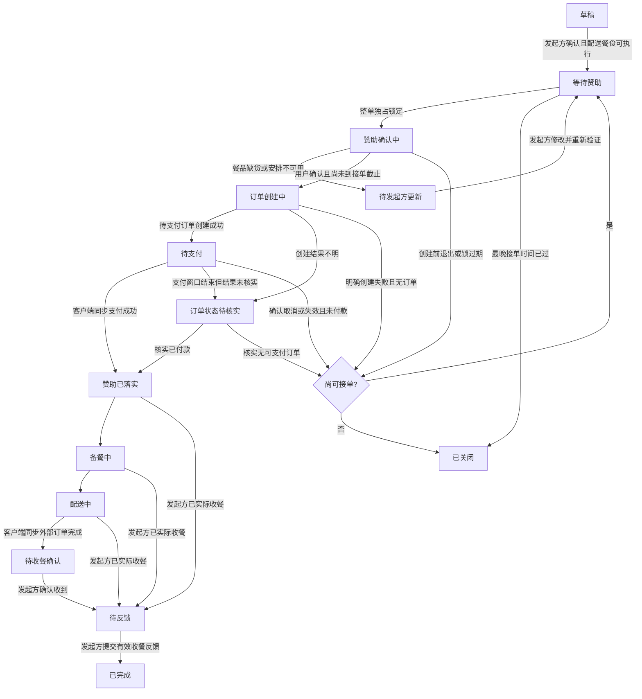
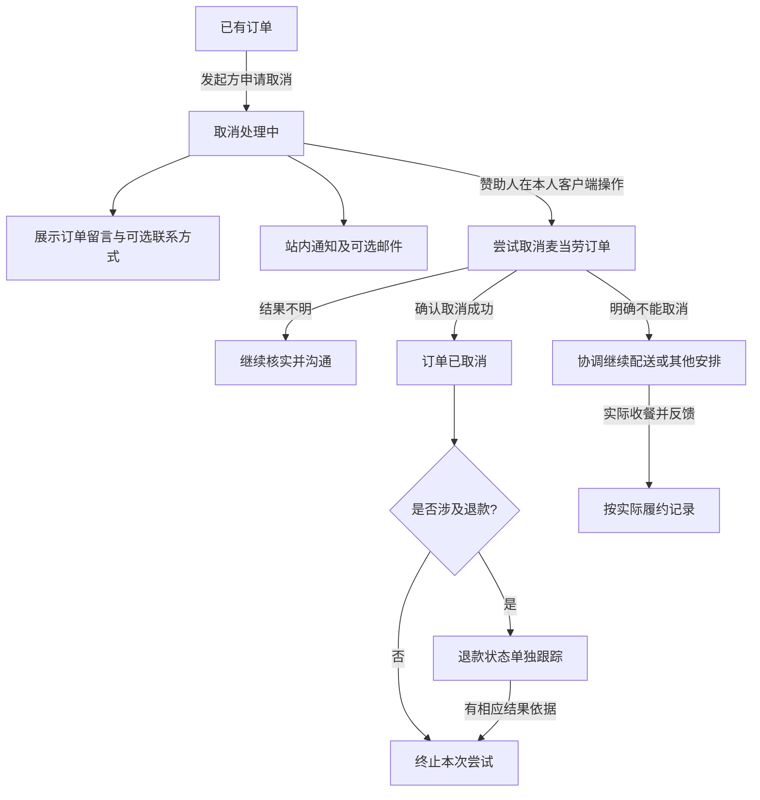
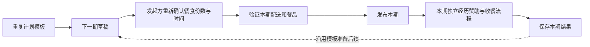

# Mc4Need 生命周期与状态图 v0.2

日期：2026-10-16。状态：产品决策的实施说明，尚未实现。页面文案已依据本轮讨论整理；内部枚举、时间公式与并发约束是建议设计，开发时需通过接口实测验证。

[产品方案](product-v0.2.md) · [验收清单](acceptance-v0.2.md)

## 1. 不混合三个对象

- **需求期次 NeedOccurrence**：一次明确餐食需求。单次需求只有一期；重复计划有多期，各期独立确认、截止、赞助和完成。
- **赞助尝试 SponsorshipAttempt**：一个赞助人对一期需求的整单承担尝试。未付款失败后可以有下一次尝试，但同一时间只允许一个有效尝试。
- **麦当劳订单报告 OrderObservation**：赞助人客户端同步的外部订单信息，带来源、原始状态和时间。它不是平台独立查询的官方证明。

取消申请、退款结果、留言与收餐反馈独立保存，不用一个 status 字段覆盖所有事实。

## 2. 主流程图

图中收餐与反馈可以一次完成提交，界面不要求用户重复操作。官方状态缺失、滞后或客户端离线时，不补造“备餐中”“配送中”等中间记录。发起方确认实际收餐可以推动餐食履约进度，但不能倒推出未经同步的付款或退款状态；冲突单保留异常标记与来源。

## 3. 页面阶段与退出条件

| 页面阶段 | 进入条件 | 后续处理 |
|---|---|---|
| 草稿 | 发起方准备需求，或重复计划创建下一期 | 发起方确认且本期可执行后发布 |
| 等待赞助 | 未到最晚接单时间、餐食可用且无有效尝试 | 原子锁定整单；截止后关闭 |
| 赞助确认中 | 一个赞助人持有短暂锁 | 重新查询实际餐食与价格；明确确认后创建订单 |
| 订单创建中 | 已发送创建请求但尚未确定结果 | 不接受第二个赞助；失败不明时转待核实 |
| 待支付 | 已获得成功创建的待支付订单 | 从创建成功计算付款时限；展示官方支付入口 |
| 赞助已落实 | 收到客户端同步的已付款报告 | 停止接受其他赞助，展示来源及同步时间 |
| 备餐中／配送中 | 有对应客户端状态报告 | 保留外部原始状态，页面映射不填补未知事实 |
| 待收餐确认 | 外部订单报告完成，发起方尚未确认收到 | 提醒发起方；不超时自动完成 |
| 待反馈 | 发起方确认收到，但未提供反馈 | 收到文本或适当链接反馈后完成 |
| 已完成 | 发起方确认收餐且反馈已返回 | 形成案例；非真实数据继续显示模拟标记 |
| 待发起方更新 | 指定餐品、配送或时间安排无法执行 | 不允许替换后自动下单；更新后重新验证 |
| 订单状态待核实 | 创建、支付、取消等结果不明 | 保留占用，通过用户查询或异常处理核对；不盲目重试 |
| 已关闭 | 无有效订单且已超接单截止，或发起方在无有效交易时关闭 | 不能继续赞助；新的安排作为更新后重新发布或新一期处理 |

“赞助已落实”的显示必须紧邻“赞助人客户端同步”和时间，不使用“平台官方认证”等字样。平台案例完成不意味着平台已独立核验整个外部支付过程。

## 4. 时间规则

以下符号为实施建议：

| 符号 | 含义 |
|---|---|
| `T_accept` | 发起方设置的本期最晚接单时间 |
| `t_created` | 麦当劳待支付订单实际创建成功的时间，不能用收到回传的时间替代 |
| `P` | 付款时限，具体分钟数待接口验证后确定 |
| `T_mcd_expire` | 麦当劳实际返回的支付有效期，若可取得 |
| `T_pay` | 此订单的有效付款截止时间 |

接单要求：`t_created <= T_accept`。截止前进入确认页面或拿到锁不算接单成功。

有官方有效期时：`T_pay = min(t_created + P, T_mcd_expire)`。

理论上的最后付款上界：`T_accept + P`，不是每位赞助人都从统一的接单截止时刻开始获得完整付款时限。例如最晚接单 11:00、付款时限 10 分钟（仅示意）：10:40 创建的订单截至 10:50；10:59 创建的订单截至 11:09，若官方更早到期则服从更早期限。

官方有效期无法取得时，不猜定时长，也不把平台倒计时结束当成官方订单已失效。若平台时限早于官方可支付期限，必须核实取消/失效或已付款，才能安全释放占用。提醒停止和实际无法付款是不同事实。

时间判定由服务端校验，客户端时间不能作为唯一依据；公开时间明确时区，首版面向中国大陆按北京时间展示。

### 截止附近的异常

- 创建请求开始于截止前，但实际成功发生在截止后：不计为正常接单；核实并尝试取消未付订单，未核实前不得释放占用或鼓励付款。
- 创建实际成功于截止前，但客户端回传晚：根据真实创建时间核对，不能仅因回传晚就把订单丢弃；标明客户端来源。
- 回传缺失或创建响应超时：可能已经有订单，进入待核实，不再次创建。
- 到截止时已有有效待支付订单：继续显示待支付至其有效期限，不把需求直接变成可重新赞助或完成。
- 所有有效尝试均已确认失败，且接单截止已过：关闭本期。

## 5. 取消与异常流程

发起方只能提出申请，不能直接调用赞助人的账号。平台不能因需求关闭就自动宣称麦当劳订单取消，不能因订单取消就宣称退款到账。已付款单取消后的重新发布不自动执行，先核对原订单、实际接收需要和本期时间条件。

## 6. 并发与记录约束

1. 一期需求同一时间只能有一个有效赞助尝试；服务端原子操作保障，前端禁用按钮不足以验收。
2. 锁在“尚未发出创建请求”阶段可以按明确超时释放；一旦可能已创建订单，转入核实阶段。
3. 同一订单报告重放不能增加完成份数，同一外部订单不能重复计入多期。客户端报告本身并非防伪证明。
4. 下单前核对需求版本；关键字段被修改后旧报价和确认失效。已有外部订单时不直接修改地址、数量或时间。
5. 用户凭证及身份控制更新权限。只知道公开需求编号或外部订单号不能改订单、读留言或提交收餐反馈。
6. 外部订单状态、取消申请、退款、收餐、反馈分别记录时间和来源；迟到报告不得无依据覆盖更新事实。
7. 最终完成只来自发起方确认收餐并反馈。没有反馈就保持等待，不能用自动任务造完成数据。
8. 完成后若出现投诉或矛盾信息，保留历史并标记异常，不静默改写已公开事实。

## 7. 重复需求

一期未完成、已关闭或异常，不自动变更另一期间的订单。后续草稿的生成与提醒方式可设计，但缺少确认绝不能自动发布。本期赞助不构成对未来订单的付款授权。
